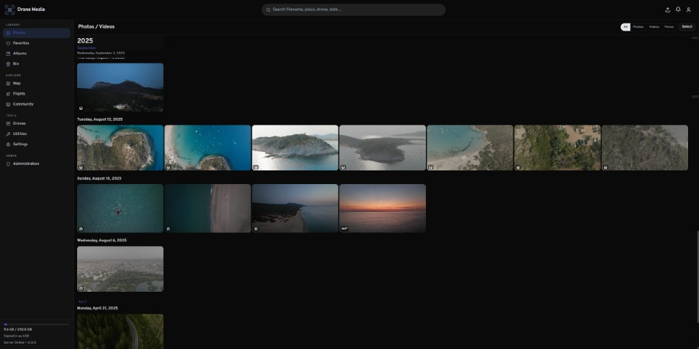
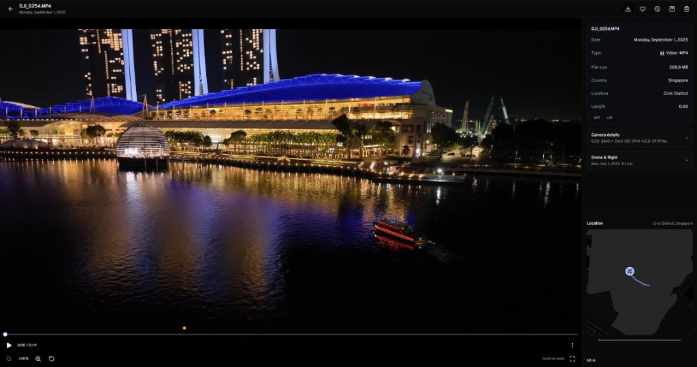
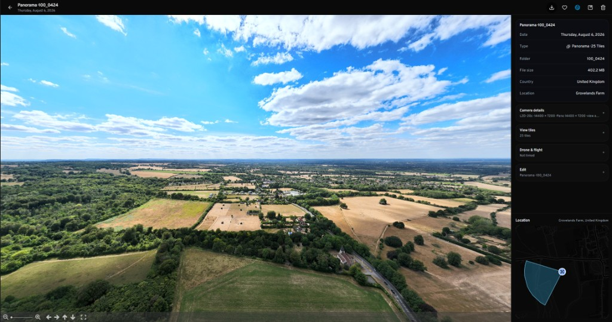
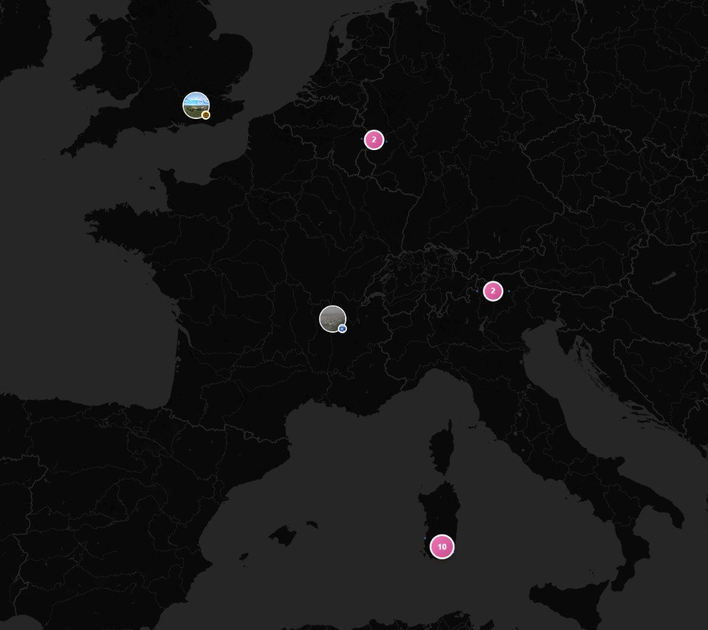
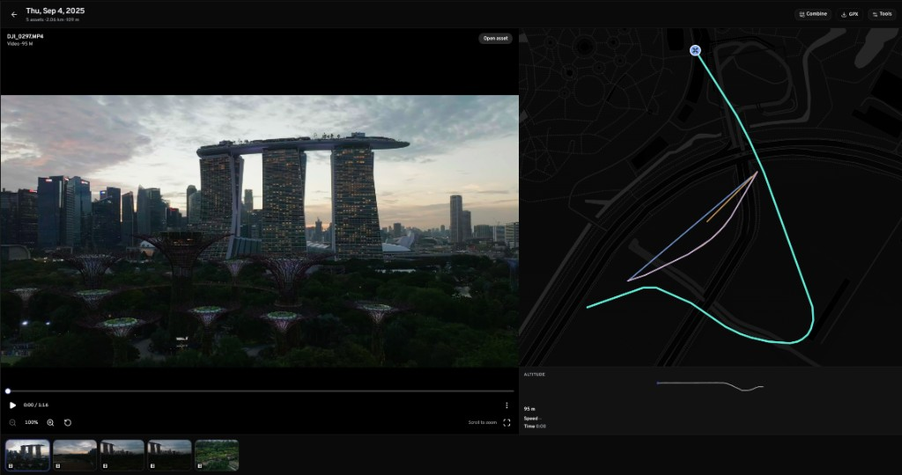
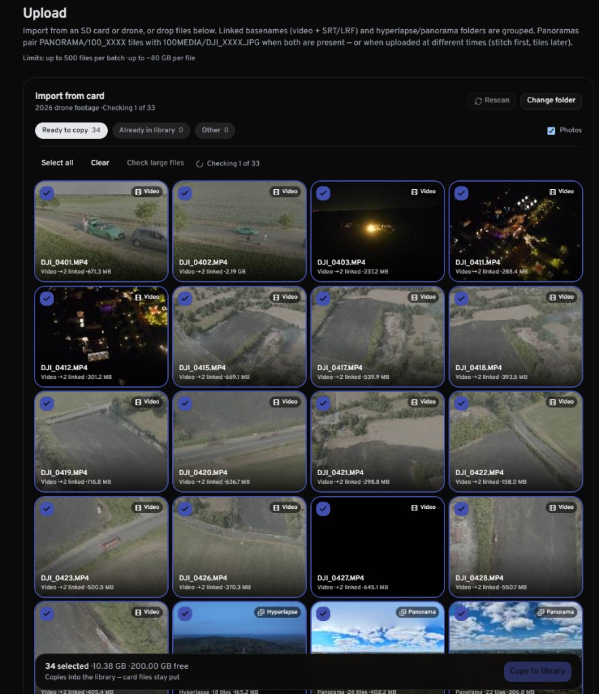
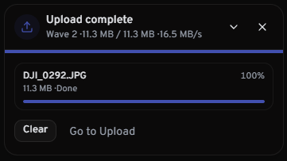
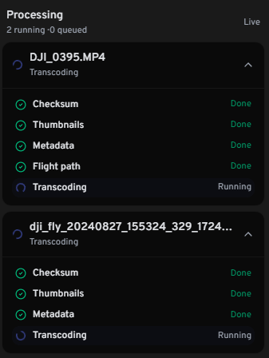

<p align="center">
  
</p>

<h1 align="center">Drone Media</h1>

<p align="center">
  <strong>Self-hosted library for drone photos, videos, and flight telemetry.</strong><br />
  Immich-like UX, built for DJI-style workflows.
</p>

## What it is

Drone Media is a multi-user web app for aerial media at home. Import from an SD card or folder, keep MP4 + SRT (+ LRF) grouped together, then browse a timeline, map, and flights with regenerable previews and HLS playback. Mark media public for Community profiles.

## Who it’s for

- Drone pilots who want an Immich-like library for flight media and telemetry
- Homelab users running Docker
- Households or small teams that need separate users, quotas, and admin tools

## Screenshots

### Timeline

Date-grouped library with type filters and media badges on each tile.



### Playback

Watch clips with metadata, linked SRT/LRF, and the telemetry path on a map.



### Panorama

Interactive 360° panoramas with a heading cue and look-direction cone on the location map.



### Map

Geotagged media with clusters and corner badges for photo, video, and panorama markers.



### Flight

Multi-clip flights with a bottom media strip, live path map, and altitude telemetry.



### Upload

Import from an SD card or drone folder. Linked basenames and sequences are grouped before you copy into the library.



### Upload progress

A compact upload dock keeps transfers visible while you browse.



### Processing

Live job status after import: checksum, thumbnails, metadata, flight path, and transcoding.



## Features

- **Library**: timeline, map, flights, albums, drones, favorites, bin
- **Upload**: chunked uploads with basename grouping (MP4 + SRT + LRF) and a progress dock
- **Playback**: HLS from cache; Source plays the original when allowed
- **Photos**: Web preview from cache; download uses full originals
- **Panoramas**: stitch, 360° viewer, heading when EXIF/DJI yaw is present
- **Flights**: grouped clips with path map, altitude graph, and media strip
- **Community**: public profiles and a shared map (`/community`, `/u/{username}`)
- **Admin**: users, invites, settings, integrity, storage, backups, jobs

While transcoding is paused, Live Processing finishes after metadata. Deferred items show under **Utilities → Jobs**. Videos without a streaming preview show a status message instead of playing Source in the player.

## Prerequisites

- Docker and Docker Compose (recommended)
- Node.js 22+ (local development only)

## Quick start (Docker)

Install from prebuilt images. No source build needed on the server.

Images (published when `main` updates):

- `ghcr.io/asb131/dronemedia-app`
- `ghcr.io/asb131/dronemedia-worker`

1. Copy install files into a folder:

   ```bash
   # at minimum:
   #   docker-compose.yml
   #   .env.example  →  .env
   #   config.yml
   cp .env.example .env
   ```

2. Edit **`.env`**:
   - `AUTH_SECRET`: long random string (required)
   - `PUBLIC_URL`: URL you open in the browser (for example `http://192.168.1.177:3384`)
   - `UPLOAD_LOCATION_*`: host paths for postgres, redis, cache, and media

3. Create the host directories, then pull and start:

   ```bash
   # Example Linux layout (match UPLOAD_LOCATION_* in .env)
   sudo mkdir -p /mnt/ssd1_system/docker/dronemedia/postgres \
     /mnt/ssd1_system/docker/dronemedia/redis \
     /mnt/ssd2_cache/dronemedia/cache \
     /mnt/hdd1_personal/dronemedia/media
   # Redis official image runs as uid 999
   sudo chown -R 999:999 /mnt/ssd1_system/docker/dronemedia/redis

   docker compose pull
   docker compose up -d
   ```

4. Open `PUBLIC_URL`. On first boot, the setup wizard creates the admin account.

**Upgrades:** `docker compose pull && docker compose up -d` (optionally set `APP_VERSION` in `.env` to pin a tag).

**Always run both `app` and `worker`.** Without the worker you will not get thumbnails, HLS, photo web previews, or telemetry jobs.

Default web port is **3384** (container listens on 2283). Postgres and Redis stay internal.

If `docker compose pull` fails with unauthorized on GHCR, make the `dronemedia-app` and `dronemedia-worker` packages **public** under the GitHub repo Packages settings.

### Useful commands

```bash
docker compose ps
docker compose logs -f app worker
docker compose restart worker
docker compose pull && docker compose up -d   # upgrade
docker compose down   # data on bind mounts / volumes is kept
```

## Storage tiers

| Tier | In-container path | Purpose |
|------|-------------------|---------|
| App | `/data/app` | LUTs, small app state (Docker volume by default) |
| Cache | `/data/cache` | Regenerable: thumbs, HLS, proxies, web photo previews, uploads |
| Media | `/data/media` | Originals (bind to HDD) |
| Postgres | `/var/lib/postgresql/data` | PostGIS (bind to SSD) |
| Redis | `/data` | Sessions, BullMQ queues (bind to SSD; `chown 999:999`) |

If Redis logs show permission errors on the RDB file, fix host ownership (`chown -R 999:999` on the Redis bind) and restart Redis.

Backups: database (`pg_dump` / admin backup) plus **media** originals. Cache can be wiped and rebuilt.

## Local development

### Docker from source

`docker-compose.yml` pulls GHCR images. To build locally:

```bash
cp docker-compose.override.example.yml docker-compose.override.yml
# edit host paths in the override
docker compose up -d --build
```

Or:

```bash
docker compose -f docker-compose.yml -f docker-compose.build.yml up -d --build
```

### Node without full stack rebuild

```bash
cp .env.example .env
npm install
mkdir -p data/app data/cache data/media

docker compose up -d postgres redis
npm run db:migrate
npm run dev      # Next.js (default port 2283 locally)
npm run worker   # BullMQ workers (separate terminal)
```

Health: `GET /api/health`.

## Configuration

- **`config.yml`**: operator settings (storage, upload limits, transcoding, quotas, cron)
- **`.env`**: secrets and overrides (`AUTH_SECRET`, `PUBLIC_URL`, `DATABASE_URL` for local runs)

`PUBLIC_URL` and `AUTH_TRUST_HOST=true` are required for Auth.js when using a LAN IP:port.

Docker sets in-container `CACHE_PATH` / `MEDIA_PATH` / `APP_DATA_PATH` to `/data/...`. Edit **host bind mounts**, not those env values.

## Community and profiles

- **`/community`**: profile list and optional map of public geotagged assets
- **`/u/{username}`**: public profile for assets marked public

Signed-in users browse Community. Public profile media is served under `/api/public/...`.

## Project structure

```
src/app/           Next.js App Router + API routes
src/components/    UI
src/lib/           config, db, storage, jobs helpers
workers/           BullMQ processors (thumbnails, metadata, HLS, …)
drizzle/           SQL migrations
docker/            entrypoint + migrate scripts
config.yml         default operator config
docker-compose.yml production stack
```

Media on disk: `MEDIA_PATH/{userId}/{assetId}/{ext}`. Display names live in the database only.

## Database

```bash
npm run db:generate   # after schema changes
npm run db:migrate
npm run db:studio     # optional
```

PostGIS is enabled during migrate (`CREATE EXTENSION IF NOT EXISTS postgis`).

## Backup and admin recovery

- **Database**: admin backup / `pg_dump`
- **Media**: rsync or snapshot of the media bind mount
- **Cache**: optional; regenerable

Reset or grant admin:

```bash
npm run reset-admin -- --username admin --password newpass
npm run reset-admin -- --grant-admin --username someuser
```

Or via Docker:

```bash
docker compose exec app npm run reset-admin -- --username admin --password newpass
```

## License

AGPL-3.0. See [LICENSE](./LICENSE).

## Version

Current release: **1.0.6**

`GET /api/health` and the sidebar footer report the running version (`APP_VERSION` / package version).

### v1.0.6

- Security hardening: DB re-check of approval/role, revoked sessions enforced, login redirect sanitization
- PIN and registration rate limits; share unlock requires `AUTH_SECRET`
- Security headers, tighter middleware static bypass, zip entry name sanitization
- Anonymous public viewers cannot request Source originals; health endpoint is status/version only

### v1.0.5

- Immich-style chrome: nav order and selected pill, black/white theme, header search, letter avatar, storage card
- Photos timeline: month scrubber, justified rows, small gaps between tiles
- Map heatmap toggle for geotagged media
- Cinematic library player (shuffle, web previews, LUT, all / favourites / albums)

### v1.0.4

- Upload sidecars (SRT/LRF) attach only with the same folder + basename
- CLI `npm run repair-cross-attached-sidecars -- --apply` detaches cross-attached SRT/LRF

### v1.0.3

- Timeline: no duplicate tiles on infinite scroll; select all / unselect all
- Upload: folder-aware grouping; safer sidecar attach
- Dedup from primary video/photo hashes only
- Thumbnails: owner check + cache-busting URLs

### v1.0.2

- Upload staging cleanup and admin “Clean upload staging now”
- Clearer jobs / finalize status during library transfer
- Upload waves capped by file count or ~8 GB

### v1.0.1

- Timeline and map performance polish
- Clearer upload status; download/ETA wrapping
- 180° panoramas use the photo Web/Source viewer
- Admin Source gate; library + disk storage displays
- Asset refresh and Utilities duplicate helpers
